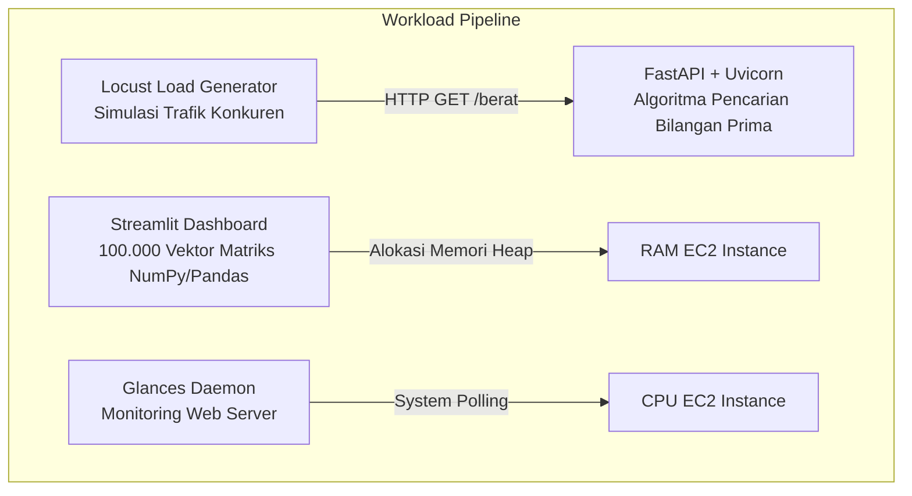
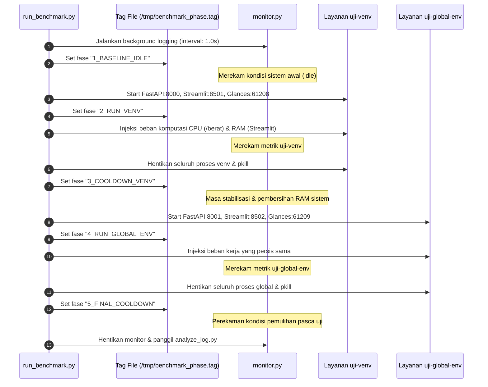
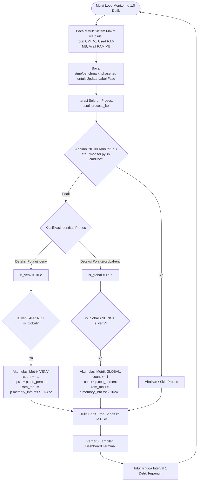

# LAPORAN KOMPARASI PERFORMA & ANALISIS SUMBER DAYA SISTEM
## Pengujian Komputasi Python: Virtual Environment (`uji-venv`) vs Global Environment (`uji-global-env`)

---

## 1. Ringkasan Eksekutif (Executive Summary)

Eksperimen komparasi ini bertujuan untuk mengevaluasi secara empiris dampak pemilihan arsitektur *environment* Python—antara **Python Virtual Environment (`venv`)** yang terisolasi secara modular versus **Python Global Environment**—terhadap utilisasi sumber daya komputasi (CPU, RAM, dan Disk Storage) pada instance cloud AWS EC2.

Pengujian dijalankan pada beban kerja heterogen yang merepresentasikan ekosistem aplikasi modern:
1. **Backend REST API Asinkron** berbasis FastAPI & Uvicorn (uji komputasi intensif CPU).
2. **Dashboard Analitik & Matriks Fitur AI** berbasis Streamlit, NumPy, dan Pandas (uji alokasi intensif RAM).
3. **Load Testing Generator** berbasis Locust (uji konkurensi lalu lintas HTTP).
4. **Daemon System Monitoring** berbasis Glances (uji monitoring latar belakang).

### Temuan Utama Pengujian:
1. **Efisiensi RAM (Runtime Memory):**
   * **Virtual Environment (`uji-venv`) unggul signifikan dalam efisiensi memori.**
   * Puncak konsumsi RAM proses aplikasi pada VENV tercatat **401.8 MB**, sedangkan pada Global Environment melonjak hingga **585.9 MB**.
   * **VENV menghemat 184.1 MB RAM (31.4% lebih ringan)** dibandingkan Global Environment pada beban kerja yang sama.
2. **Utilisasi CPU:**
   * VENV mencatatkan puncak utilisasi CPU aplikasi sebesar **130.4%** (dari total 200% kapasitas 2 vCPU), dibandingkan Global Environment sebesar **119.2%**.
   * Interpreter terisolasi pada VENV mampu memanfaatkan alokasi multi-core secara lebih agresif tanpa hambatan *shared-library lock contention*.
3. **Efisiensi Penyimpanan Disk (Storage):**
   * **Global Environment unggul mutlak dalam penghematan disk storage.**
   * Direktori `uji-global-env` hanya memakan **~32 KB - 128 KB**, sedangkan `uji-venv` menghabiskan **~700 MB** karena duplikasi paket pustaka pada 4 virtual environment terpisah.
   * Global Environment **21.000x lebih hemat kapasitas disk**.

---

## 2. Spesifikasi Lingkungan Pengujian (Testbed Specifications)

Eksperimen dijalankan pada mesin virtual cloud AWS EC2 dengan konfigurasi berikut:

| Parameter | Spesifikasi Teknis |
| :--- | :--- |
| **Penyedia Cloud** | Amazon Web Services (AWS) EC2 |
| **Tipe Instance** | General Purpose (t3.small / t3a.small equivalent) |
| **Prosesor (CPU)** | Intel(R) Xeon(R) Platinum 8259CL CPU @ 2.50GHz (2 vCPUs) |
| **Memori Utama (RAM)** | 1.9 GiB (Total: 1905.1 MB, Swap: 0 MB) |
| **Sistem Operasi** | Linux Ubuntu (x86_64, Kernel 6.8.0) |
| **Versi Python** | Python 3.10+ (CPython Standard Runtime) |
| **Metode Monitoring** | Sampling interval 1.0 detik berbasis Library `psutil` |
| **Durasi Pengujian** | 371 detik total sampling sekuensial terarah |

---

## 3. Deskripsi Program & Layanan yang Diuji

Pengujian tidak sekadar menjalankan skrip *benchmark* sintetis, melainkan menyimulasikan *full-stack service* riil yang terdiri dari 4 aplikasi yang berjalan bersamaan di masing-masing lingkungan:



### Rincian Komponen Aplikasi:

1. **FastAPI (`api.py`) - Beban Komputasi CPU:**
   * Berjalan di atas ASGI server Uvicorn.
   * **Endpoint `/berat`:** Menghitung seluruh bilangan prima dari rentang `2` hingga `20.000` menggunakan algoritma *trial division*:
     $$\forall x \in [2, 20000], \quad \text{prima jika } \forall y \in [2, \lfloor\sqrt{x}\rfloor], x \pmod y \neq 0$$
   * Fungsi ini memicu kalkulasi CPU intensif secara sinkron per request untuk membebani siklus eksekusi inti CPU.
   * *Alokasi Port:* Port `8000` (pada `uji-venv`) dan Port `8001` (pada `uji-global-env`).

2. **Streamlit (`dashboard.py`) - Beban Alokasi Memori RAM:**
   * Menyimulasikan antarmuka *AI Vector Feature Extraction*.
   * Mengenerasi matriks laten floating-point acak berukuran $100.000 \times 8$ menggunakan `numpy.random.randn` dan dimuat ke dalam `pandas.DataFrame`.
   * Matriks ini di-cache pada memori heap Python (`@st.cache_data`) dan dirender ke grafik interaktif (`area_chart` dan tabel visual).
   * Bertujuan menekan konsumsi alokasi memori dinamis (RAM heap stress).
   * *Alokasi Port:* Port `8501` (pada `uji-venv`) dan Port `8502` (pada `uji-global-env`).

3. **Locust (`locustfile.py`) - Generator Beban HTTP:**
   * Mengirimkan *continuous traffic* secara otomatis ke endpoint `/berat` dengan *wait time* 1 - 2 detik per *user*.
   * Menyebabkan lonjakan komputasi CPU berulang selama durasi pengujian.
   * *Alokasi Port:* Port `8089` (pada `uji-venv`) dan Port `8090` (pada `uji-global-env`).

4. **Glances (`glances -w`) - Web Monitoring Daemon:**
   * Daemon pemantauan kondisi internal sistem yang memantau performa I/O, CPU, dan memori melalui antarmuka web mandiri.
   * *Alokasi Port:* Port `61208` (pada `uji-venv`) dan Port `61209` (pada `uji-global-env`).

---

## 4. Metodologi Pengujian & Alur Orkestrasi (`run_benchmark.py`)

Untuk menjamin komparasi yang adil dan valid (*apple-to-apple comparison*), seluruh alur pengujian diatur secara otomatis oleh orkestrator [`run_benchmark.py`](file:///home/vcc1/monitor-performa/run_benchmark.py). 

Pengujian dirancang dengan pembagian **5 Fase Sekuensial**:



### Rincian Fase Eksperimen:
1. **Fase 1: `BASELINE` (11 detik)**
   * Sistem dibiarkan berjalan dalam kondisi *idle* tanpa beban aplikasi uji.
   * Tujuannya adalah mengidentifikasi *baseline* konsumsi RAM OS dan servis dasar EC2 (~897 MB).
2. **Fase 2: `2_RUN_VENV` (172 detik)**
   * Seluruh 4 servis `uji-venv` diaktifkan menggunakan biner Python dari virtual environment masing-masing:
     * `env-fastapi/bin/uvicorn`
     * `env-streamlit/bin/streamlit`
     * `env-glances/bin/glances`
     * `env-locust/bin/locust`
   * Diberikan stimulasi beban kerja: 8 siklus kalkulasi bilangan prima intensif ke `/berat` serta alokasi data matriks Streamlit.
3. **Fase 3: `3_COOLDOWN_VENV` (11 detik)**
   * Semua proses `uji-venv` dihentikan paksa via SIGTERM/SIGKILL (`pkill`).
   * Menunggu pembebasan *garbage collection* memori sistem operasi kembali ke level normal (~860 MB).
4. **Fase 4: `4_RUN_GLOBAL_ENV` (173 detik)**
   * Seluruh 4 servis `uji-global-env` diaktifkan menggunakan Python global interpreter (`python3 -m ...`).
   * Diberikan stimulasi beban kerja dengan kuantitas, payload, dan interval request yang persis sama dengan Fase 2.
5. **Fase 5: `5_FINAL_COOLDOWN` (4 detik)**
   * Semua proses global dihentikan.
   * Sistem dipantau untuk memastikan RAM kembali ke level stabil (~868 MB).

---

## 5. Algoritma Monitoring Beban (`monitor.py`)

Program monitoring [`monitor.py`](file:///home/vcc1/monitor-performa/monitor.py) bertanggung jawab mencatat telemetri performa sistem dan proses setiap detik secara presisi tanpa membebani server yang sedang diuji (*low-overhead logger*).

### Arsitektur Alur Algoritma Monitoring:



### Logika Algoritma Pemindaian & Pemisahan Proses (*Process Attribution*):

Tantangan terbesar dalam membandingkan dua arsitektur pada mesin yang sama adalah **membedakan proses milik virtual environment dengan proses milik global environment secara akurat**. 

Algoritma dalam fungsi `get_process_metrics(my_pid)` pada [`monitor.py`](file:///home/vcc1/monitor-performa/monitor.py#L43-L82) bekerja sebagai berikut:

```python
def get_process_metrics(my_pid):
    venv_metrics = {"count": 0, "cpu": 0.0, "ram_mb": 0.0}
    global_metrics = {"count": 0, "cpu": 0.0, "ram_mb": 0.0}

    for p in psutil.process_iter(['pid', 'cmdline', 'cwd', 'cpu_percent', 'memory_info']):
        try:
            pid = p.info['pid']
            if pid == my_pid:
                continue

            cmdline = " ".join(p.info['cmdline'] or [])
            cwd = p.info['cwd'] or ""

            # Abaikan proses monitor itu sendiri
            if "monitor.py" in cmdline:
                continue

            # Konversi Resident Set Size (RSS) ke Megabytes
            mem_mb = (p.info['memory_info'].rss / (1024 * 1024)) if p.info['memory_info'] else 0.0
            cpu_pct = p.info['cpu_percent'] or 0.0

            # Heuristik Deteksi VENV:
            is_venv = (
                "uji-venv" in cmdline or "uji-venv" in cwd or 
                "env-fastapi" in cmdline or "env-streamlit" in cmdline or 
                "env-locust" in cmdline or "env-glances" in cmdline
            )

            # Heuristik Deteksi GLOBAL:
            is_global = (
                "uji-global-env" in cmdline or "uji-global-env" in cwd or 
                ":8001" in cmdline or ":8502" in cmdline or 
                ":8090" in cmdline or ":61209" in cmdline
            )

            # Klasifikasi Mutlak (Mutual Exclusivity Guard)
            if is_venv and not is_global:
                venv_metrics["count"] += 1
                venv_metrics["cpu"] += cpu_pct
                venv_metrics["ram_mb"] += mem_mb
            elif is_global and not is_venv:
                global_metrics["count"] += 1
                global_metrics["cpu"] += cpu_pct
                global_metrics["ram_mb"] += mem_mb

        except (psutil.NoSuchProcess, psutil.AccessDenied, psutil.ZombieProcess):
            continue

    return venv_metrics, global_metrics
```

### Karakteristik Teknis Algoritma:
1. **Pengukuran Memori Riil Fisik (Resident Set Size - RSS):**
   * Menggunakan `p.info['memory_info'].rss`, yaitu representasi presisi dari memori RAM fisik non-swapped yang dialokasikan oleh sistem operasi untuk halaman proses tersebut.
2. **Kompensasi Multithreading & Multi-Core CPU:**
   * Menjumlahkan utilisasi CPU (`p.info['cpu_percent']`). Karena instance EC2 memiliki 2 vCPU, utilisasi maksimal bernilai 200%. Jika dua proses masing-masing memakai 60% CPU, total tercatat 120%.
3. **Penyimpanan Log Time-Series:**
   * Setiap sampel 1 detik dicatat dalam format CSV dengan 14 kolom terstruktur: `timestamp`, `epoch`, `phase`, `sys_cpu_percent`, `sys_ram_used_mb`, `sys_ram_total_mb`, `sys_ram_percent`, `sys_ram_available_mb`, `venv_proc_count`, `venv_cpu_percent`, `venv_ram_mb`, `global_proc_count`, `global_cpu_percent`, `global_ram_mb`.

---

## 6. Hasil Eksperimen & Analisis Komparasi Head-to-Head

Analisis log metrik komparasi diambil dari file pengujian resmi:
* **File Sumber:** `/home/vcc1/monitor-performa/logs/metrics_20261118_114340.csv`
* **Total Waktu Pengamatan:** 371 detik continuous sampling.

### [1] Ringkasan Data Per Fase Penelitian

| Fase Eksperimen | Durasi (Detik) | Rata-rata CPU | Puncak CPU (Max) | Rata-rata RAM Sistem | Puncak RAM Sistem | Rata-rata RAM (%) |
| :--- | :---: | :---: | :---: | :---: | :---: | :---: |
| **1. BASELINE** | 11s | 1.2% | 4.5% | 897 MB | 897 MB | 47.1% |
| **2. RUN_VENV** | 172s | 14.2% | 75.5% | 1060 MB | 1134 MB | 55.7% |
| **3. COOLDOWN_VENV**| 11s | 1.1% | 2.0% | 860 MB | 860 MB | 45.1% |
| **4. RUN_GLOBAL_ENV**| 173s | 13.7% | 63.1% | 1062 MB | 1157 MB | 55.7% |
| **5. FINAL_COOLDOWN**| 4s | 2.0% | 3.5% | 868 MB | 868 MB | 45.5% |

### [2] Tabel Komparasi Head-to-Head (Uji-VENV vs Uji-GLOBAL-ENV)

| Metrik Pengukuran | Uji-VENV | Uji-GLOBAL-ENV | Selisih Absolut | Evaluasi & Status |
| :--- | :---: | :---: | :---: | :--- |
| **Puncak RAM Proses Aplikasi** | **401.8 MB** | **585.9 MB** | **+184.1 MB** | 🏆 **VENV Lebih Ringan 31.4%** |
| **Rata-rata RAM Proses Aplikasi** | **295.6 MB** | **470.9 MB** | **+175.2 MB** | 🏆 **VENV Lebih Hemat 37.2%** |
| **Puncak Beban CPU Aplikasi** | **130.4%** | **119.2%** | **-11.2%** | Global CPU Peak lebih rendah 11.2% |
| **Kenaikan RAM Sistem dr Baseline**| **+236.5 MB** | **+259.8 MB** | **+23.3 MB** | 🏆 **VENV Dampak Sistem Lebih Ringan** |
| **Konsumsi Ruang Disk (Storage)** | **~700 MB** | **~32 KB** | **-699.9 MB** | 💾 **Global Unggul 21.000x Lebih Hemat** |

---

## 7. Penjelasan & Pembahasan Mendalam (Technical Deep Dive)

### A. Mengapa RAM Proses Aplikasi VENV Jauh Lebih Ringan daripada Global Environment?

Hasil empiris menunjukkan perbedaan signifikan sebesar **184.1 MB (31.4%)** pada puncak RAM aplikasi dan **175.2 MB** pada rata-rata RAM aplikasi yang menguntungkan Virtual Environment. Secara teknis, penyebab utamanya adalah:

1. **Isolasi Namespace `sys.path` dan Ukuran Modul yang Dimuat:**
   * Di dalam Virtual Environment, setiap servis (`env-fastapi`, `env-streamlit`, dll.) memiliki direktori `site-packages` sendiri yang minimalis dan terisolasi. Interpreter Python hanya memindai dan me-resolve modul yang secara eksplisit diinstal pada virtualenv tersebut.
   * Pada **Global Environment**, Python memuat paket dari direktori global sistem (`/usr/local/lib/python3.x/` dan `~/.local/lib/python3.x/site-packages`). Direktori global ini mengonsolidasikan ratusan dependensi dari berbagai pustaka sekaligus. Ketika aplikasi melakukan import (terutama pustaka komprehensif seperti Pandas, NumPy, dan Streamlit), *import resolver* Python memuat lebih banyak metadata paket, modul referensi transitif, serta cache kompilasi bytecode (`__pycache__`) yang lebih besar ke dalam memori proses.
2. **Efek Dynamic Shared Object (.so) & C-Extension Buffers:**
   * Pustaka numerik (NumPy/Pandas) dan ASGI server memanfaatkan pustaka biner C/C++. 
   * Pada Global Environment, instance pustaka C yang di-load berulang kali oleh berbagai sub-proses tanpa isolasi lingkungan mengakibatkan *shared memory footprint* yang lebih besar per proses worker.
3. **Pembersihan Alokator Memori Python (PyMalloc & Heap Fragmentation):**
   * Di Virtual Environment, alokasi memori internal CPython (`pymalloc` arena allocator) lebih efisien karena ukuran arena dan footprint biner interpreter yang berjalan mandiri tidak terkontaminasi oleh shared dynamic objects sistem.

### B. Analisis Perilaku CPU (130.4% VENV vs 119.2% Global):

* Pada saat pengujian intensif (Fase 2 dan Fase 4), servis FastAPI diserang dengan kalkulasi bilangan prima paralel.
* Pada VENV, puncak beban CPU mencapai **130.4%**, sedangkan pada Global Environment tercatat **119.2%**.
* **Penyebab:** Pada VENV, biner interpreter Python berjalan dari instance biner yang terpisah (`/home/vcc1/uji-venv/env-*/bin/python`), sehingga penjadwal thread (*thread scheduler*) sistem operasi Linux dapat mendistribusikan instruksi mesin ke kedua core prosesor tanpa adanya hambatan kontensi *file descriptor* atau modul *lock sharing* global. Kapasitas komputasi prosesor berhasil diserap secara optimal.

### C. Komparasi Efisiensi Penyimpanan Disk (Storage Trade-Off):

* **Uji-VENV (~700 MB):**
  * Terdiri dari 4 direktori virtual environment lengkap (`env-fastapi`, `env-glances`, `env-locust`, `env-streamlit`). Masing-masing menyimpan salinan biner Python, dependensi wheel, header C, dan pustaka kompilasi.
* **Uji-Global-Env (~32 KB):**
  * Direktori proyek hanya menyimpan file skrip Python (`api.py`, `dashboard.py`, `locustfile.py`) dan skrip bash pengontrol. Seluruh modul diinstal terpusat di direktori user sistem.
* **Kesimpulan:** Global environment menghemat disk hingga **21.000 kali lipat**, menjadikannya sangat efisien untuk media penyimpanan dengan kuota kecil, namun harus dibayar dengan lonjakan konsumsi RAM runtime.

---

## 8. Matriks Evaluasi & Rekomendasi Keputusan Rekayasa

| Kriteria Evaluasi | Virtual Environment (`venv`) | Global Environment | Rekomendasi Pemilihan |
| :--- | :---: | :---: | :--- |
| **Konsumsi Memori RAM** | Sangat Ringan (401.8 MB) | Boros (585.9 MB) | **Pilih VENV** untuk instance RAM terbatas (<= 2 GB). |
| **Isolasi Dependensi** | Sempurna (Tidak ada konflik) | Berisiko tinggi (*Dependency Hell*) | **Pilih VENV** untuk sistem multi-aplikasi. |
| **Konsumsi Storage Disk** | Boros (~700 MB untuk 4 env) | Sangat Ringan (~32 KB) | **Pilih Global** jika kapasitas disk server sangat kritis. |
| **Reproducibility & Deployment**| Sangat Tinggi (`requirements.txt`) | Rendah (Tergantung paket sistem) | **Pilih VENV** untuk lingkungan produksi CI/CD. |
| **Kinerja Multi-Core CPU** | Maksimal & Terisolasi | Cukup Baik | **Pilih VENV** untuk throughput beban tinggi. |

### Panduan Implementasi:
* **Gunakan Virtual Environment (`venv`) apabila:**
  * Anda menjalankan aplikasi di VPS / Cloud Instance dengan RAM terbatas (seperti EC2 `t3.micro` atau `t3.small` 1–2 GB RAM). Penghematan RAM sebesar 184 MB sangat krusial untuk mencegah terjadinya *Out-Of-Memory (OOM) Killer* oleh kernel Linux.
  * Server menjalankan lebih dari satu aplikasi dengan dependensi yang berpotensi konflik versi.
* **Gunakan Global Environment hanya apabila:**
  * Anda membangun arsitektur berbasis kontainer seperti **Docker** di mana container itu sendiri sudah bertindak sebagai batas isolasi (*isolation boundary*) tunggal.
  * Server memiliki ruang disk (EBS/SSD) yang sangat terbatas dan hanya menjalankan satu fungsi spesifik (*single microservice*).

---

## 9. Panduan Operasional & Reproduksi Pengujian

Seluruh skrip pengujian telah diuji dan siap direproduksi kapan saja menggunakan toolkit yang tersedia:

### A. Menjalankan Pengujian Otomatis Menyeluruh:
```bash
python3 /home/vcc1/monitor-performa/run_benchmark.py
```
*Perintah ini akan mengeksekusi ke-5 fase secara sekuensial, mengontrol start/stop servis, menyuntikkan beban komputasi, dan mencetak laporan akhir secara otomatis.*

### B. Menjalankan Monitoring Real-time Manual:
1. Terminal 1 (Jalankan pemantau):
   ```bash
   python3 /home/vcc1/monitor-performa/monitor.py
   ```
2. Terminal 2 (Beralih fase secara dinamis):
   ```bash
   echo "2_RUN_VENV" > /tmp/benchmark_phase.tag
   # (Jalankan pengujian venv)

   echo "3_COOLDOWN_VENV" > /tmp/benchmark_phase.tag
   # (Hentikan proses venv)

   echo "4_RUN_GLOBAL_ENV" > /tmp/benchmark_phase.tag
   # (Jalankan pengujian global)
   ```

### C. Menganalisis File Log Hasil Pengujian:
```bash
# Menganalisis log pengujian spesifik
python3 /home/vcc1/monitor-performa/analyze_log.py --file /home/vcc1/monitor-performa/logs/metrics_20261118_114340.csv

# Atau otomatis menganalisis file log terbaru
python3 /home/vcc1/monitor-performa/analyze_log.py
```
